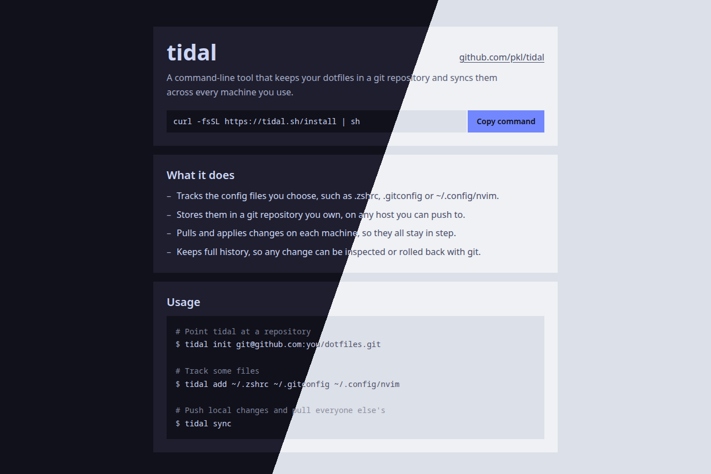
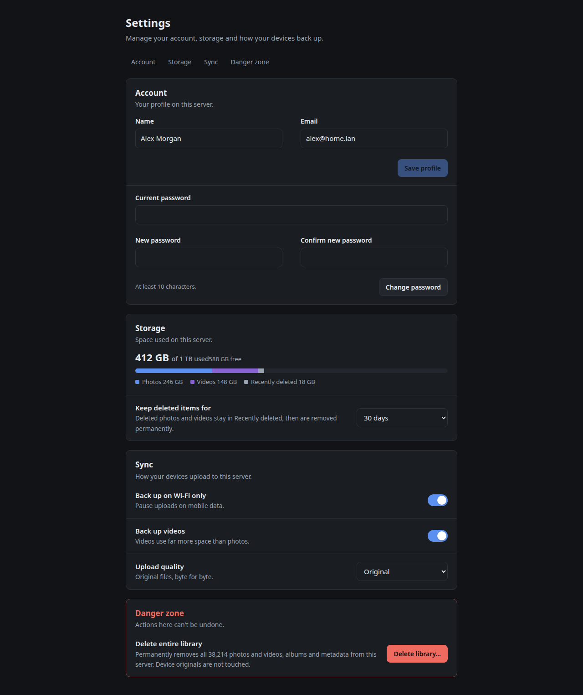
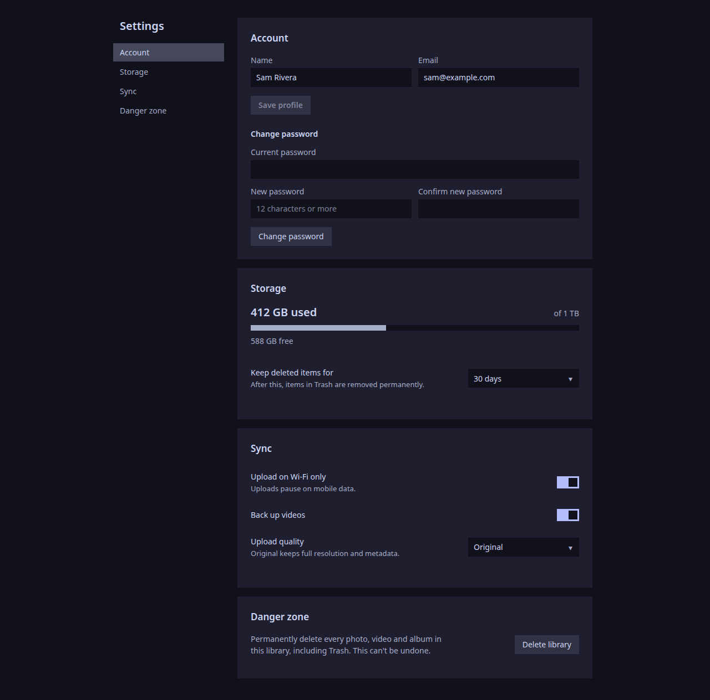
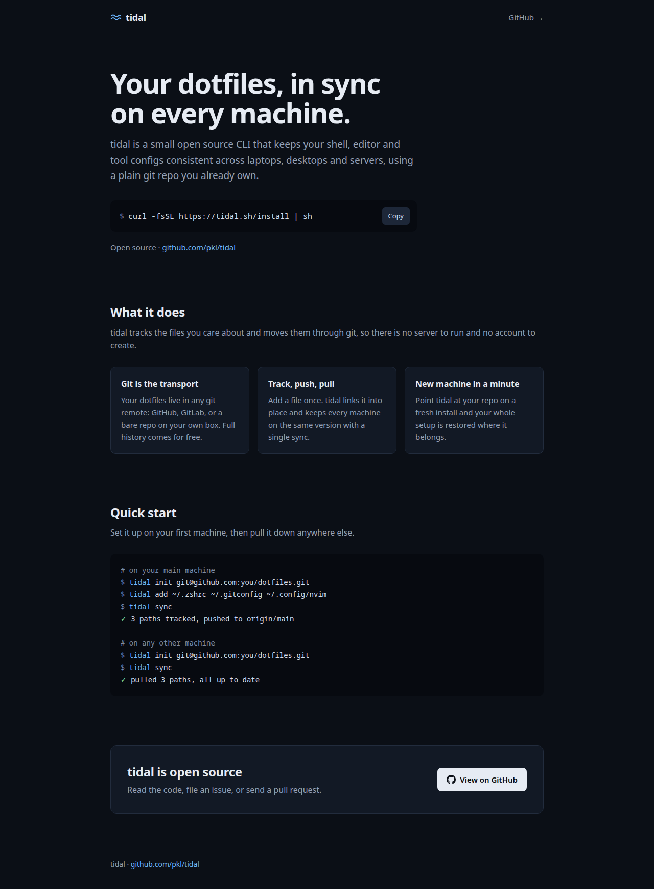
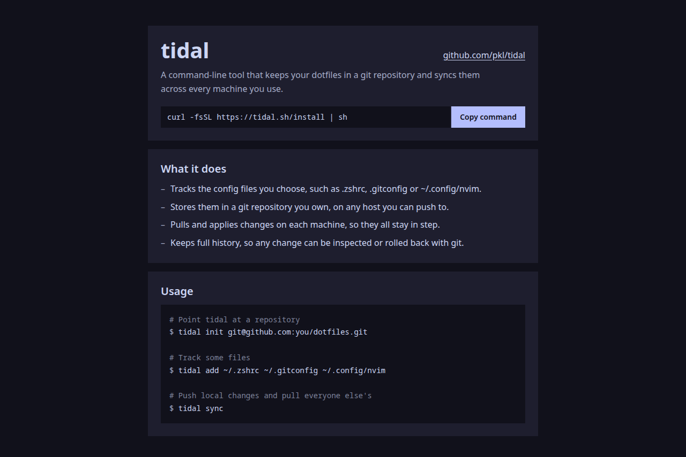
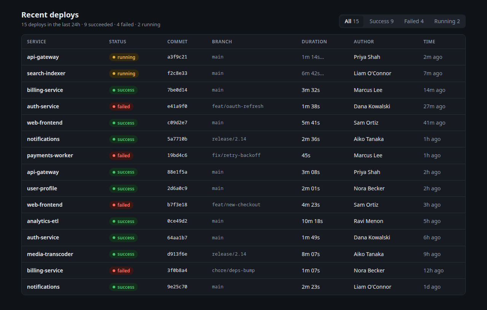
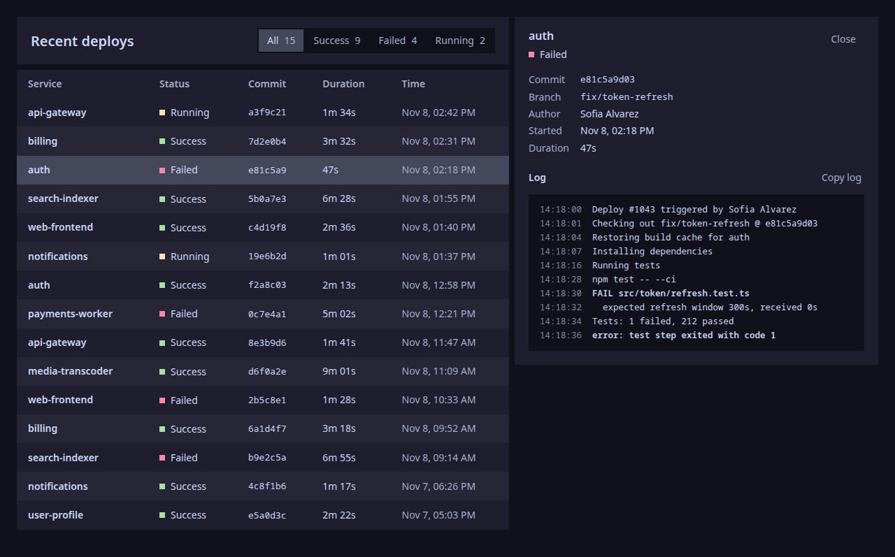

# ui²

A Claude skill for square, quiet interfaces on Catppuccin, without the usual AI slop.

## What it does

- Uses Catppuccin Mocha in dark mode and Latte in light mode, with crust as the background and lavender as the only accent.
- Separates elements with contrasting surfaces instead of borders, shadows or gradients.
- Removes every corner radius unless you ask for one.
- Leaves out AI-slop patterns like pill badges, eyebrows, all-caps labels, pulsing "live" dots, invented stats and filler copy.
- Ships `scripts/slop_check.py`, which Claude runs on its output to catch anything that slipped through.

## Examples

The same prompts, without and with the skill.

| Without | With |
|---|---|
|  |  |
|  |  |
|  |  |
